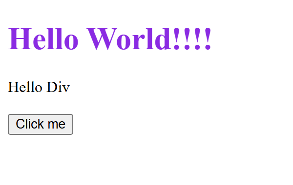

# Declaración del Uso de Inteligencia Artificial

**Actividad:** Actividad Integradora 1: Desarrollo de un portafolio personal
**Asignatura:** Programación de Sistemas Web

## Declaración

Declaro que durante el desarrollo de esta actividad utilicé herramientas de inteligencia
artificial generativa, como se detalla a continuación.

**Herramienta utilizada:** Claude Web (Anthropic).

**Fases del proyecto en las que se empleó:**

- Repaso de los temas vistos en clase (HTML, CSS y JavaScript) mediante guías de estudio
  generadas a partir de los ejercicios del curso.
- Revisión de la estructura HTML y de los estilos CSS del portafolio.
- Creación del avatar ilustrado y de las capturas de los proyectos de clase usadas como imágenes.
- Redacción del archivo README.md.
- Revisión de errores en el código de los ejercicios de clase.

## Prompts principales utilizados

# Prompt 1

Estoy creando una pagina web pero el menú no se despliega bien y no me sirven los enlaces. Que puede ser?

### Respuesta

Revisé tu `index.html` y hay tres problemas concretos:

**1. Etiqueta mal escrita en el primer elemento del menú**

```html
<l><a href="#inicio">Inicio</a></li>
```

Abres con `<l>` (que no existe) y cierras con `</li>`. El navegador lo interpreta mal y el primer elemento queda fuera de la lista, por eso el menú se ve descuadrado. Debe ser:

```html
<li><a href="#inicio">Inicio</a></li>
```

**2. Usas `<ol>` en vez de `<ul>`**

`<ol>` es una lista *ordenada*, así que el navegador le pone números (1, 2, 3…). Para un menú de navegación lo normal es `<ul>`. Si quieres mantenerlo horizontal y sin viñetas, en tu CSS:

```css
.menu {
    list-style: none;
    display: flex;
    gap: 20px;
    margin: 0;
    padding: 0;
}
```

**3. Los enlaces apuntan a secciones que no existen**

Tus enlaces van a `#sobre-mi`, `#habilidades`, `#proyectos` y `#contacto`, pero en el HTML solo existe la sección con `id="inicio"`. Un enlace con `#algo` solo funciona si hay un elemento con ese mismo `id`. Por eso "Ver mis proyectos" y casi todo el menú no hacen nada. Agrega las secciones dentro de `<main>`, aunque sea vacías por ahora:

```html
<section id="sobre-mi">
    <h2>Sobre mí</h2>
</section>

<section id="habilidades">
    <h2>Habilidades</h2>
</section>

<section id="proyectos">
    <h2>Proyectos</h2>
</section>

<section id="contacto">
    <h2>Contacto</h2>
</section>
```

Los `id` deben coincidir exactamente con el `href` (sin el `#`, mismas minúsculas y guiones).

**El menú corregido completo:**

```html
<nav aria-label="Principal">
    <ul class="menu">
        <li><a href="#inicio">Inicio</a></li>
        <li><a href="#sobre-mi">Sobre mí</a></li>
        <li><a href="#habilidades">Habilidades</a></li>
        <li><a href="#proyectos">Proyectos</a></li>
        <li><a href="#contacto">Contacto</a></li>
    </ul>
</nav>
```

Si después de esto el menú sigue viéndose raro, pásame tu `css/styles.css` y lo reviso. Verifica también que el archivo esté de verdad en la carpeta `css/` junto a `index.html`, porque si la ruta falla no se aplica ningún estilo.

# Prompt 2

En la seccion habilidades todo me sale a la izquierda y no se aplica el formato correcto en una lista. Cual puede ser el error?

### Respuesta

Hay tres errores en esa sección, y todos son de nombres que no coinciden entre el HTML y el CSS:

**1. La clase de la sección no existe en tu CSS (por eso todo sale a la izquierda)**

```html
<section id="habilidades" class="seccion-habilidades">
```

En tu CSS no hay ninguna regla `.seccion-habilidades`. La que centra el contenido y le da el ancho máximo es `.seccion` (con `max-width: 900px` y `margin: 0 auto`). Cámbiala igual que en "Sobre mí":

```html
<section id="habilidades" class="seccion">
```

**2. La primera lista usa una clase que tampoco existe**

```html
<ul class="lenguajes">
```

Tu CSS le da el formato de "tarjetas" en fila a `.habilidades` (sin viñetas, con `flex` y `gap`). Como `.lenguajes` no está definida, esa lista sale con viñetas y en vertical. Las otras dos listas sí se ven bien porque usan la clase correcta. Debe ser:

```html
<ul class="habilidades">
```

**3. La etiqueta de cierre está rota**

```html
/section>
```

Le falta el `<`. El navegador lo muestra como texto y la sección queda sin cerrar. Debe ser:

```html
</section>
```

**Otro detalle que afecta tu menú:** la sección "Sobre mí" tiene `id="sobre"`, pero el enlace del menú apunta a `#sobre-mi`. No coinciden, así que ese enlace no funciona. Cambia el id a `id="sobre-mi"`. Recuerda también que todavía faltan las secciones `#proyectos` y `#contacto`, por eso esos enlaces y el botón "Ver mis proyectos" aún no hacen nada.

Una regla que te ahorra estos errores: cada clase o id que escribas en el HTML tiene que estar escrito exactamente igual en el CSS o en el `href`. Si no coinciden letra por letra, simplemente no se aplica.

# Prompt 3

En proyectos no me aparecen las imagenes. Y me salen los proyectos en vertical, quiero ponerlos en una sola fila los 3 proyectos

### Respuesta

Son dos problemas distintos, uno en el HTML y otro en el CSS.

**1. Las imágenes no aparecen: la etiqueta está mal escrita**

En las tres tarjetas escribiste `<imag`:

```html
<imag src="img/proyecto1.png" alt="...">
```

La etiqueta correcta es ``. Como `<imag>` no existe, el navegador la ignora y no carga nada. Corrige las tres:

```html

```

Después de corregirlo, si alguna imagen sigue sin verse, revisa que los archivos existan en la carpeta `img/` con el mismo nombre y extensión (`proyecto1.png`, no `Proyecto1.PNG` ni `.jpg`).

**2. Las tarjetas salen en vertical: falta la regla `.tarjeta`**

En tu CSS no existe `.tarjeta` entre `.proyectos` y `.tarjeta img`. Sin un ancho asignado, cada tarjeta se estira según su texto, ocupa toda la fila y, como tienes `flex-wrap: wrap`, la siguiente baja a otra línea.

Agrega esto en ese espacio vacío:

```css
.tarjeta {
    box-sizing: border-box;
    width: 280px;
    padding: var(--espacio);
    background-color: var(--color-blanco);
    border: 2px solid #b8cddd;
    border-radius: var(--bordes);
}
```

`flex: 1 1 250px` hace que las tres tarjetas se repartan el ancho por igual. Con el contenedor de 900px de `.seccion` caben las tres en una fila. El `250px` es el ancho mínimo antes de que bajen a otra línea, así que en celular se acomodan una debajo de otra en lugar de quedar aplastadas. Si las quieres siempre en fila sin importar el tamaño de pantalla, quita `flex-wrap: wrap` de `.proyectos`, aunque en celular se verán muy angostas.

El resto (borde, fondo blanco y relleno) es para que se vean como tarjetas, con el mismo estilo que tus habilidades.

# Prompt 4

Estoy tatando de poner un menú hamburguesa pero cuando pongo la pagina para movil, esta muestra el icono de hamburguesa pero no abre el menu. Me sale este error en la consola del explorador: 

Uncaught TypeError: document.QuerySelectorAll is not a function
express-utils.js:18 [Intervention] Slow network is detected. See https://www.chromestatus.com/feature/5636954674692096 for more details. Fallback font will be used while loading: 

index.html:19 Uncaught ReferenceError: abrirmenu is not defined
    at HTMLButtonElement.onclick (index.html:19:102)

### Respuesta

El error de "Slow network" puedes ignorarlo, es solo un aviso del navegador sobre la carga de fuentes. Los otros dos errores sí son tuyos, y hay un tercer problema que la consola no reporta:

**1. `QuerySelectorAll` con mayúscula**

JavaScript distingue mayúsculas de minúsculas. El método se llama `querySelectorAll`, con `q` minúscula:

```js
const enlaces = document.querySelectorAll(".menu a");
```

**2. El nombre de la función no coincide**

En el HTML llamas a `abrirmenu()` (todo minúscula), pero en el JS la función se llama `abrirMenu` (con `M` mayúscula). Para JavaScript son dos nombres distintos, por eso dice "is not defined". Corrígelo en el HTML:

```html
<button class="menu-hamburguesa" type="button" aria-label="Abrir menú" onclick="abrirMenu()">
```

**3. El evento se llama `"click"`, no `"onclick"`**

En `addEventListener` el nombre del evento va sin el prefijo `on`. Con `"onclick"` no da error, simplemente nunca se ejecuta, así que el menú no se cerraría al elegir una opción.

**Extra: el menú solo abre, nunca cierra con el botón**

Tu comentario dice "muestra u oculta", pero `classList.add` solo agrega la clase. Usa `toggle`, que la agrega si no está y la quita si ya está.

**Tu `script.js` corregido:**

```js
// Menu hamburguesa para celulares

// Muestra u oculta el menu al presionar el boton
function abrirMenu() {
    const menu = document.querySelector(".menu");
    menu.classList.toggle("activo");
}

// Cierra el menu cuando se elige una opcion
const enlaces = document.querySelectorAll(".menu a");

for (let i = 0; i < enlaces.length; i++) {
    enlaces[i].addEventListener("click", function () {
        document.querySelector(".menu").classList.remove("activo");
    });
}
```

Tu CSS está bien, no necesita cambios. Con estas correcciones el botón abre y cierra el menú, y al tocar un enlace el menú se cierra solo.
