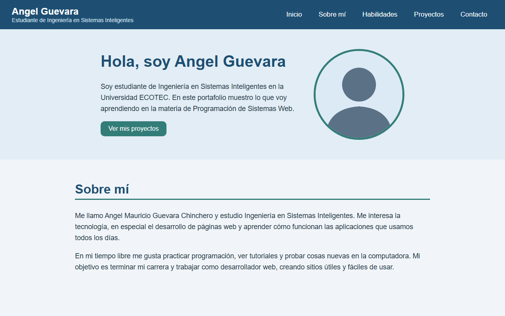

# Portafolio Personal

**Estudiante:** Angel Mauricio Guevara Chinchero  
**Materia:** Programación de Sistemas Web - Universidad ECOTEC

## Descripción

Este es mi portafolio personal para la Actividad Integradora 1. En la página presento
información sobre mí, mis habilidades, algunos proyectos que hice en clases y un
formulario de contacto.

El sitio tiene las siguientes secciones:

- Encabezado con mi nombre y menú de navegación (con menú hamburguesa en celulares)
- Sección principal con una breve presentación y mi avatar
- Sobre mí
- Habilidades
- Proyectos
- Contacto (formulario visual, no envía datos)
- Pie de página

## Tecnologías utilizadas

- HTML5 (etiquetas semánticas: header, nav, main, section, article, footer)
- CSS3 (variables, flexbox, hover, media queries)
- JavaScript (menú hamburguesa)
- Git y GitHub

## Estructura del proyecto

```
portafolio/
├── index.html
├── README.md
├── css/
│   └── styles.css
├── js/
│   └── script.js
└── img/
    ├── avatar.png
    ├── captura.png
    ├── proyecto1.png
    ├── proyecto2.png
    └── proyecto3.png
```

## Cómo ver el proyecto

1. Descargar o clonar el repositorio:
   ```
   git clone https://github.com/aguevaranv/portafolio-personal.git
   ```
2. Abrir la carpeta del proyecto.
3. Hacer doble clic en el archivo `index.html` para abrirlo en el navegador.

## Captura de pantalla


